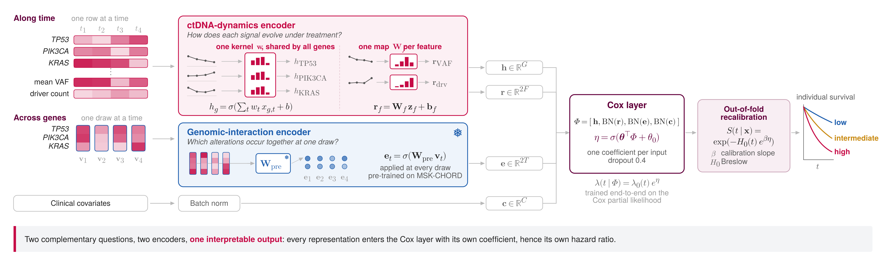
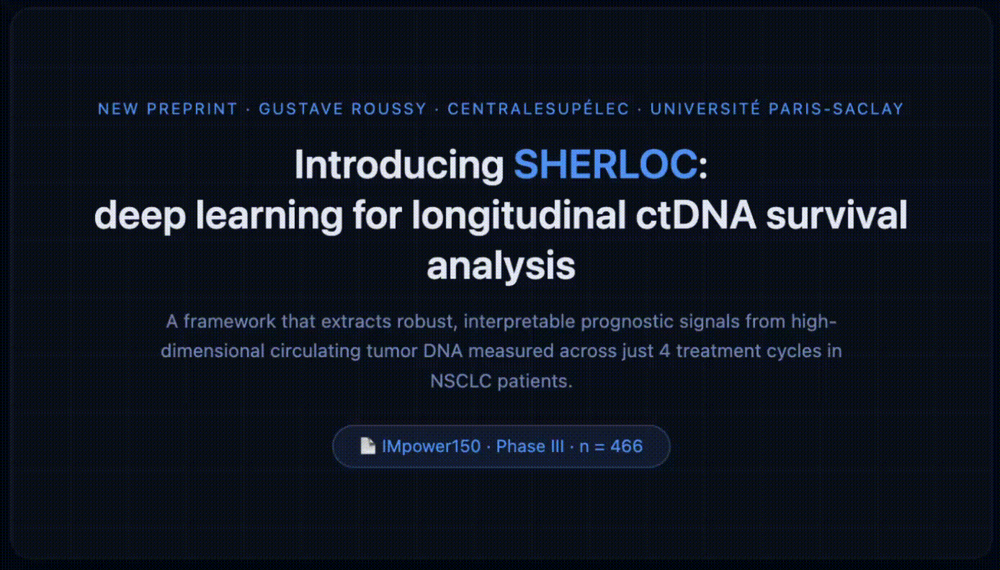

# SHERLOC

**SHERLOC: an interpretable deep-learning model of longitudinal ctDNA for calibrated early treatment monitoring in advanced breast cancer (PADA-1) and non-small-cell lung cancer (IMpower150)**

SHERLOC (*Shared and Exclusive Representations of Longitudinal ctDNA*) reads the same ctDNA data along time and across
genes, and feeds every learned representation to a Cox layer with its own coefficient.



## 🎬 Interactive Overview



👉 [Full interactive presentation](https://aaronmamanntoledano.github.io/SHERLOC/)

---

[](https://www.python.org/)
[](LICENSE)
[](https://github.com/psf/black)
[](https://github.com/astral-sh/ruff)
[](https://doi.org/10.64898/2026.06.04.730097)
[]()

---

SHERLOC is a deep learning framework specifically designed for survival analysis within the constraints of clinical trials, characterized by short longitudinal trajectories, high-dimensional genomic data, and limited sample sizes.

---

## 📖 Overview

Trials sample plasma at two to four time points, panels measure tens of genes and cohorts include a few hundred
patients. SHERLOC is built for this setting, with very few parameters per kind of information:

*   **ctDNA-dynamics encoder (shared and exclusive temporal representations):** one temporal kernel shared by all
    gene-level VAF trajectories, and one temporal map per panel-level feature (mean VAF, driver count, cfDNA
    concentration, early-response features).
*   **Genomic-interaction encoder:** pre-trained on the overall survival of 24,947 patients with tissue sequencing
    (MSK-CHORD) and frozen; it encodes the mutation profile at each draw, and batch normalisation adapts it to plasma.
*   **Cox layer:** every representation and clinical covariate enters with its own coefficient.
*   **Out-of-fold recalibration:** the bounded risk score is rescaled into calibrated individual survival
    probabilities without changing the ranking of patients (`sherloc/recalibration.py`).

### Key findings (V2: PADA-1 and IMpower150)

*   **Discrimination:** best C-index and integrated AUC among twelve methods (deep, recurrent and attention-based
    networks, penalised Cox models, random survival forests, FPCRF, Bayesian joint model) on 100 identical splits:
    C-index 0.696 / iAUC 0.770 in IMpower150 (landmark C4D1) and 0.733 / 0.765 in PADA-1 (landmark at cycle 2).
*   **Added value over clinical covariates** (10 × 5-fold cross-fitting): C-index 0.73 vs 0.62 (PADA-1) and 0.70 vs 0.63
    (IMpower150); at 80% specificity, 60% of the patients who died within the horizon were flagged vs 34% and 44%
    with the clinical model.
*   **Beyond radiological response:** SHERLOC risk groups separate survival within RECIST stable disease and partial
    response in both trials and outperform the absence of objective response and ctDNA-response rules at the same
    flagging rate.
*   **Interpretability:** calibrated marginal effects, checked across independently trained models, show that the
    score is driven by panel-level ctDNA burden and its on-treatment change, and by the mutation profile through the
    pre-trained encoder (TP53, KEAP1, KRAS in NSCLC; TP53 vs FOXA1 and GATA3 in breast cancer).

---

## 🛠 Technical Setup & Installation

To ensure the DL_models package is recognized correctly across the project and to avoid ModuleNotFoundError, follow these installation steps:

### 1. Clone & Environment

```bash
git clone https://github.com/AaronMamannToledano/SHERLOC.git
cd SHERLOC
python -m venv venv
source venv/bin/activate  # Windows: venv\Scripts\activate
pip install -r requirements.txt
```

### 2. Install SHERLOC Package

Install the repository in editable mode. This allows the scripts in the `scripts/` folder to import from `DL_models` seamlessly:

```bash
pip install -e .
```

---

## 💻 Usage

To run one of the proposed deep learning models, use the module flag from the project root. This ensures all internal paths are resolved correctly:

```bash
python -m scripts.train_DL --config path/to/your_config.yaml
```

To train the classical baselines or joint models instead:

```bash
python -m scripts.train_ML       --config scripts/config.yaml   # Penalized Cox + RSF
python -m scripts.train_ML_FPCA  --config scripts/config.yaml   # FPCA + penalized Cox
Rscript scripts/train_jm.R                                      # Joint models
```

---

## 🔬 Reproducing the paper

**V2 (PADA-1 and IMpower150):** see [`analyses/v2/README.md`](analyses/v2/README.md), which maps every figure and
table of the article to the script that produces it.

**V1 (IMpower150):**

| Figure / table | Script |
| --- | --- |
| Deep-learning benchmark (iAUC, C-index, IBS) | `scripts/train_DL.py` |
| Penalized Cox / RSF baselines | `scripts/train_ML.py` |
| FPCA + penalized Cox baselines | `scripts/train_ML_FPCA.py` |
| Joint-model baselines | `scripts/train_jm.R` |
| SHERLOC interpretability plots | `scripts/explainability.py` |

All scripts read hyperparameters from `scripts/config.yaml`; copy it and pass `--config`
to vary settings without editing the default file.

---

## 📊 Data

SHERLOC was developed on two cohorts. Neither is redistributed with this repository:

- **MSK-CHORD** — used to pre-train the Genomic Interaction Encoder. Available from
  [cBioPortal](https://www.cbioportal.org/study/summary?id=msk_chord_2024) under their
  data-use terms. Place the unpacked files under `scripts/data/msk_chord/`.
- **PADA-1 (target cohort, V2)** — ER+/HER2− advanced breast cancer (NCT03079011), plasma sequenced with
  Guardant360 LDT (497 genes). Deidentified data are available on request to Unicancer
  (pada-1@unicancer.fr), subject to the trial's data access policy.
- **IMpower150 (target cohort)** — longitudinal ctDNA + survival data deposited at the
  European Genome-Phenome Archive under accession
  [EGAS00001006703](https://ega-archive.org/studies/EGAS00001006703).
  Access is controlled by the original study sponsor; see `scripts/data/target/README.md`
  for the expected file layout.

---

## 🧪 Development

```bash
pip install -e ".[dev]"
ruff check .
black --check .
pytest
```

See [CONTRIBUTING.md](CONTRIBUTING.md) for the full contributor guide.

---

## 📄 Citation

The SHERLOC manuscript is currently **under peer review**. Until the paper is
out, please cite the preprint directly:

```bibtex
@article{mamann_sherloc_2026,
  author  = {Mamann, Aaron and Das, Jyotishka and Benkirane, Hakim and Bugiotti, Francesca
             and Bernard, Elsa and Besse, Benjamin and Michiels, Stefan and Cournede, Paul-Henry},
  title   = {SHERLOC: an interpretable deep-learning model of longitudinal ctDNA for calibrated early
             treatment monitoring in advanced breast cancer (PADA-1) and non-small-cell lung cancer
             (IMpower150)},
  journal = {bioRxiv},
  year    = {2026},
  doi     = {10.64898/2026.06.04.730097},
  url     = {https://doi.org/10.64898/2026.06.04.730097}
}
```

> Once accepted, please replace this entry with the published journal reference.

---

## 📁 Project Structure

```text
SHERLOC/
├── sherloc/                              # Core architecture and encoders
│   ├── __init__.py
│   ├── ctDNA_Dynamics_Encoder/
│   │   ├── __init__.py
│   │   ├── SHERLOC.py                    # Proposed Method
│   │   ├── Featurewise_Transformer.py    # Feature-wise Transformer
│   │   ├── Temporal_Transformer.py       # Temporal Transformer
│   │   ├── GRU.py                        # Gated Recurrent Unit
│   │   ├── RNN.py                        # Recurrent Neural Network
│   │   └── MLP_DeepSurv.py               # Multi-Layer Perceptron
│   ├── Genomic_Interaction_Encoder/
│   │   ├── __init__.py
│   │   └── MLP_SolidBiopsy.py            # Pre-trained tissue encoder
│   ├── losses.py                         # Cox loss defined on event-free mini-batches
│   ├── recalibration.py                  # Out-of-fold recalibration (slope + Breslow)
│   └── utils.py                          # Attention-based architecture
│
├── scripts/
│   ├── __init__.py
│   ├── config.yaml                       # Configuration file for all scripts
│   ├── train_DL.py                       # Training & evaluation — Deep-Learning models
│   ├── train_ML.py                       # Training & evaluation — penalized Cox / RSF
│   ├── train_ML_FPCA.py                  # Training & evaluation — FPCA + penalized Cox
│   ├── train_jm.R                        # Training & evaluation — joint models
│   ├── prepare_jm_data.py                # Data preparation for joint-model training
│   ├── explainability.py                 # Explainability / interpretability for SHERLOC
│   ├── utils.py                          # Data loading, pretraining, latent feature extraction
│   ├── results/                          # Cross-validated metrics (CSV outputs)
│   └── data/
│       ├── analysis_main.R               # R analysis entry point
│       ├── config.R                      # R configuration
│       ├── msk_chord/                    # Pre-training cohort (MSK-CHORD)
│       │   └── README.md
│       └── target/                       # Target cohort with longitudinal ctDNA (e.g., IMpower150)
│           └── README.md
│
├── analyses/
│   └── v2/                               # V2 article: PADA-1 and IMpower150 (see its README)
│
├── docs/
│   ├── index.html                        # Interactive overview (GitHub Pages)
│   ├── preview.gif                       # Animated preview for README
│   └── sherloc_architecture.{svg,png}    # Architecture figure (Figure 1b of the V2 article)
│
├── tests/                                # Smoke tests run in CI
│   ├── __init__.py
│   ├── test_smoke.py
│   ├── test_losses.py
│   └── test_recalibration.py
│
├── .github/
│   ├── workflows/
│   │   └── ci.yml                        # Lint + pytest on push / PR
│   ├── ISSUE_TEMPLATE/
│   │   ├── bug_report.yml
│   │   ├── feature_request.yml
│   │   └── config.yml
│   └── pull_request_template.md
│
├── pyproject.toml                        # Build, dependencies, ruff / black / pytest config
├── requirements.txt                      # Pinned runtime dependencies
├── setup.py                              # Compatibility stub (config lives in pyproject.toml)
├── CITATION.cff                          # "Cite this repository" metadata
├── CHANGELOG.md
├── CONTRIBUTING.md                       # Contributor guide
├── REPO_CLEANUP.md                       # One-time housekeeping checklist
├── LICENSE
├── .gitignore
└── README.md
```

---

## 📜 License

Released under the [MIT License](LICENSE).